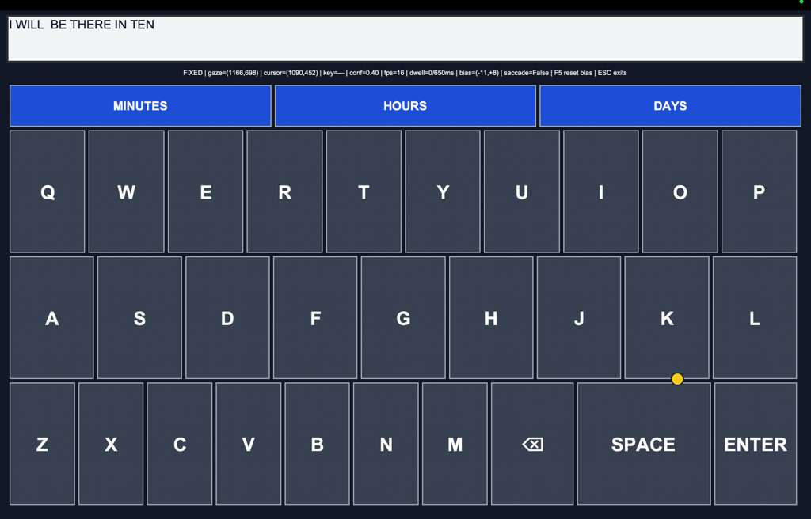

# Gaze Estimation Project

A webcam-based gaze estimation project with a calibrated, dwell-based on-screen
keyboard and a keyboard interaction study workflow.

## Requirements

- Python 3.10 is recommended.
- A webcam and a display.
- Tkinter for the calibration and keyboard windows. It is included with many Python
  installations; on Linux, install the distribution's Tk package if needed.
- A compatible gaze-model checkpoint in `models/` (see [Model files](#model-files)).
- A CUDA-capable PyTorch installation is optional. The examples below use CPU.

On macOS, allow the terminal or IDE running Python to access the camera in **System
Settings → Privacy & Security → Camera**.

## Setup

Run commands from the repository root:

```bash
python3 -m venv .venv
source .venv/bin/activate
python -m pip install --upgrade pip
python -m pip install -r requirements.txt
```

On Windows PowerShell, activate the environment with:

```powershell
py -3.10 -m venv .venv
.\.venv\Scripts\Activate.ps1
python -m pip install --upgrade pip
python -m pip install -r requirements.txt
```

If PowerShell blocks activation, use the Python executable directly:
`.venv\Scripts\python.exe`.

## Model files

The keyboard uses the gaze checkpoint at `models/L2CSNet_mpiigaze.pkl` by default.
Make sure this file is present before running calibration or the keyboard; you can
provide a different compatible checkpoint using `--model`.

## Ollama word suggestions

The keyboard's default suggestion service is a local Ollama server using
`llama3.1:8b`. Install Ollama from [ollama.com](https://ollama.com), then download
the model:

```bash
ollama pull llama3.1:8b
```

Make sure Ollama is running before starting the keyboard or its evaluation. If it
isn't already running as a service, start it in a separate terminal:

```bash
ollama serve
```

The keyboard sends requests to `http://localhost:11434/v1/chat/completions`. To
use another Ollama model, download it with `ollama pull <model>` and pass its name
with `--llm-model`.

## Keyboard calibration

Calibrate on the same key and suggestion-slot layout used by the final keyboard.
The collector records gaze and head-pose samples for each target key.

```bash
# Example command; change the output filename/path to suit your run.
python collect_keyboard_calibration_ui_matched.py \
  --fullscreen \
  --output calibration_keyboard.csv \
  --model models/L2CSNet_mpiigaze.pkl \
  --camera 0 \
  --samples-per-key 50 \
  --settle-seconds 1.5 \
  --suggestion-slots 3
```

Look at the center of each highlighted target until the collector advances. Press
**Esc** to stop; a CSV stopped before all targets are collected is incomplete and
should not be used as a full calibration.

`calibration_keyboard.csv` is an example filename, not a required name. Set
`--output` to any desired CSV filename or path, then use that same path for
`--calibration` or `--calibration-csv` when running the keyboard or evaluator.

For the calibration to match the live keyboard, use the same monitor, camera
position, window mode, model, and number of suggestion slots in both commands.
The default camera ID is `0`; change `--camera` if your webcam uses another ID.

## Live keyboard

After completing keyboard-layout calibration, run the final live keyboard with
the selected calibration, dwell, filtering, and suggestion settings:



*Live gaze-controlled keyboard; the words in the suggestion bar are generated by
the LLM.*

```bash
# Example command; change the calibration and output paths as needed.
python gaze_keyboard_live_ui.py \
  --calibration calibration_keyboard.csv \
  --model models/L2CSNet_mpiigaze.pkl \
  --mode fixed --output interaction_data/trial_15.csv \
  --dwell-ms 650 --stability-ms 250 --rearm-ms 350 \
  --min-cutoff 1.0 --beta 0.004 --median-n 5 \
  --deadzone-px 20 \
  --snap-px 25 --hold-px 25 --leave-ms 150 \
  --saccade-threshold 800 --confidence-threshold 0.15 \
  --fullscreen --n-suggestions 3 \
  --llm-url http://localhost:11434/v1/chat/completions \
  --llm-model llama3.1:8b --llm-timeout 15
```

The keyboard writes its interaction log to `interaction_data/trial_15.csv` in this
example. Change `--output` to choose another CSV filename or path. The calibration
filename supplied to `--calibration` can also be changed to match the file you
collected. Press **Esc** to exit. Ollama must be running with `llama3.1:8b` pulled
as described above.

### Keyboard evaluation

Run the study evaluator with the calibration data and phrase file:

```bash
# Example evaluation command; replace participant/session IDs and file paths.
python3 study_evaluator_combined.py D03 S03 \
  --calibration-csv calibration_keyboard.csv \
  --phrase-file phrases2.txt \
  --model models/L2CSNet_mpiigaze.pkl \
  --mode fixed \
  --dwell-ms 600 \
  --stability-ms 250 \
  --rearm-ms 350 \
  --leave-ms 150 \
  --min-cutoff 1.2 \
  --beta 0.006 \
  --median-n 3 \
  --deadzone-px 15 \
  --angle-min-cutoff 3.0 \
  --angle-beta 0.1 \
  --snap-px 25 \
  --hold-px 25 \
  --sug-reach-px 30 \
  --saccade-threshold 800 \
  --confidence-threshold 0.15 \
  --fullscreen \
  --n-suggestions 3 \
  --prefetch-ms 200 \
  --llm-url http://localhost:11434/v1/chat/completions \
  --llm-model llama3.1:8b \
  --llm-timeout 15
```

The evaluator supports two phrase files: `phrases2.txt` (MacKenzie phrases) and
`nus_sms_phrases.txt` (NUS SMS phrases). Change the value of `--phrase-file` in
the example command to `nus_sms_phrases.txt` to use the NUS SMS dataset. The
participant ID, session ID, and calibration CSV path are examples and can be
changed for each run. The evaluator writes its CSV results under
`<output-root>/<participant-id>/<session-id>/` (default output root:
`interaction_data`; change it with `--output-root`). Its generated CSV basenames
are set by the evaluator; change them in the script if you need different names.

See all options with:

```bash
python study_evaluator_combined.py --help
python gaze_keyboard_live_ui.py --help
python collect_keyboard_calibration_ui_matched.py --help
```

## Notes

- Run the scripts from the repository root unless a command explicitly says
  otherwise, so their default model and output paths resolve correctly.
- Calibration and keyboard evaluation files are ignored by Git in this repository. They
  remain on your machine unless you explicitly add them to version control.
